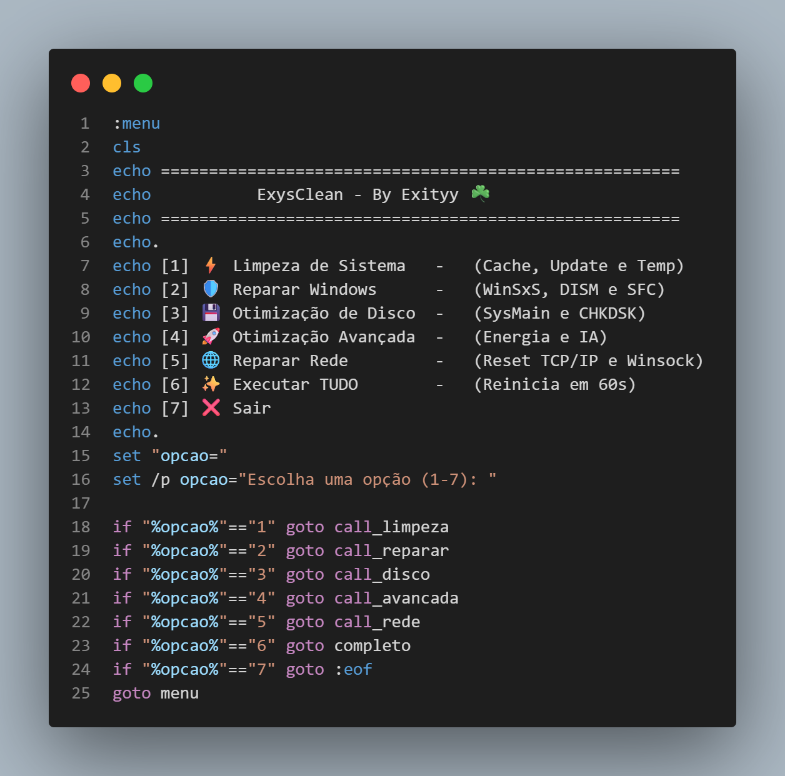

# ExysClean - Otimização de Sistema  ☘️

O **ExysClean** é um script batch leve e sem dependências, desenvolvido para otimizar o Windows, realizar manutenção preventiva e corrigir erros. O projeto foi criado para facilitar o dia a dia de profissionais de suporte e de usuários que desejam manter o sistema limpo e rápido sem instalar softwares de terceiros.

## — Funcionalidades. 🖥️

O script é dividido em módulos interativos. Escolha o que seu sistema precisa no momento:

1. **Limpeza de Sistema:** Esvazia a lixeira, remove arquivos temporários (`Temp`), limpa o cache DNS e redefine com segurança o cache do Windows Update, sem interromper serviços.
2. **Reparar Windows:** Executa uma manutenção profunda com ferramentas nativas (DISM e SFC) e remove atualizações antigas mantidas no WinSxS, liberando gigabytes de espaço.
3. **Otimização de Disco:** Pergunta se o disco é SSD ou HDD para configurar corretamente o serviço `SysMain` (evitando o uso do disco em 100%) e agenda o CHKDSK.
4. **Otimização Avançada:** Desbloqueia e ativa o plano de energia de "Desempenho Máximo" do Windows e desativa integrações nativas de IA (Copilot), que consomem recursos em segundo plano.
5. **Reparar Rede:** Faz uma redefinição completa do TCP/IP e do Winsock e renova o IP, ajudando a resolver problemas de conexão.
6. **Modo Completo:** Executa sequencialmente todas as opções de 1 a 4 e agenda a reinicialização em 60 segundos (com um botão de emergência para cancelar).

## — Screenshots 🌃

  

## — Detalhes Técnicos e Diferenciais. ⚙️

A versão 2.0 foi reescrita para ser mais segura e compatível com qualquer máquina:

- **Zero Poluição de Ambiente:** O uso de `setlocal` impede que as variáveis do script permaneçam na sessão do terminal após a execução.
- **Bypass de Idioma:** A detecção do plano de energia utiliza o GUID nativo (`e9a42b02-d5df-448d-aa00-03f14749eb61`), permitindo que funcione em sistemas em português, inglês ou qualquer outro idioma.
- **Safe-Execution:** Verifica automaticamente se o script tem privilégios de administrador no momento da execução.
- **Codificação UTF-8:** O uso de `chcp 65001` garante que caracteres especiais e emojis sejam exibidos corretamente em qualquer terminal.

## — Tecnologias Aplicadas. 👾

* **Batch Script:** Linguagem nativa para automação Windows.
* **Modularização:** Uso de `labels` e `call` para reuso de código e controle de fluxo.
* **Tratamento de Erros:** Verificação automática de privilégios de Administrador.
* **Escapamento de Caracteres:** Técnicas para garantir a integridade do pipe (`|`) em blocos lógicos complexos.

## — Como usar? 🌟

1. Baixe ou clone o repositório.
2. Clique com o botão direito do mouse no arquivo `ExyClean.bat`.
3. Selecione **"Executar como Administrador"**.
4. Escolha a opção desejada no menu numérico.
---
Desenvolvido por **Exityy! ☘️**